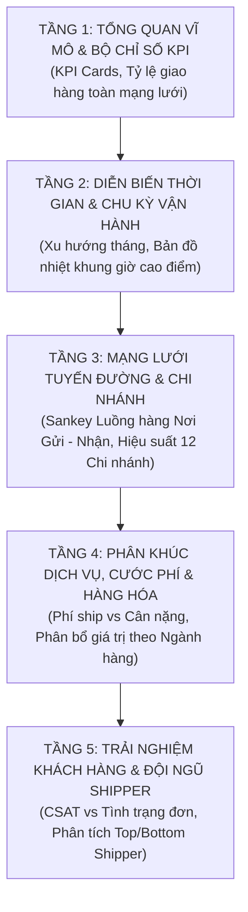

# 🚚 Kế Hoạch & Đặc Tả Trực Quan Hóa Dữ Liệu Logistics KHB (Plotly)

Tài liệu này cung cấp bản thiết kế trực quan hóa chi tiết cho bài toán **Phân tích Vận hành & Hiệu suất Logistics** của Công ty Giao nhận KHB (dữ liệu năm 2025). Bộ biểu đồ được xây dựng bằng thư viện **Plotly** theo định hướng: **Đơn giản – Trực quan – Dễ hiểu – Tương tác sâu**, dẫn dắt người xem đi từ bức tranh toàn cảnh vĩ mô (KPIs) đến từng khía cạnh vận hành chi tiết.

---

## 📌 1. Tổng Quan Về Tập Dữ Liệu `logistics_KHB.csv`

### 1.1. Thông tin kỹ thuật
- **Quy mô dữ liệu:** 10.000 dòng dữ liệu (giao dịch vận đơn), 15 cột thuộc tính.
- **Dữ liệu khuyết thiếu (Missing values):** `0` (Bộ dữ liệu hoàn chỉnh, không có giá trị null).
- **Phạm vi thời gian:** Từ `01/01/2025 00:03` đến `27/12/2025 23:46`.

### 1.2. Từ điển dữ liệu (Data Dictionary)
| Tên Cột | Kiểu Dữ Liệu | Giá Trị Mẫu / Miền Giá Trị | Ý Nghĩa Kinh Doanh |
| :--- | :--- | :--- | :--- |
| `Mã Đơn Hàng` | Chuỗi (`str`) | KHB000001, KHB000002... | Mã định danh duy nhất cho từng gói hàng |
| `Thời Gian` | Ngày giờ (`datetime`) | `dd/mm/yyyy HH:MM` (Năm 2025) | Thời điểm hệ thống ghi nhận đơn vận chuyển |
| `Chi Nhánh` | Định danh (`category`) | 12 chi nhánh (Hà Nội, ĐN, TP.HCM) | Bưu cục/Hub xử lý tiếp nhận đơn |
| `Shipper` | Định danh (`category`) | 87 nhân viên giao hàng | Tài xế phụ trách đơn giao đến khách |
| `Nơi Gửi` | Phân loại (`str`) | Hà Nội, Đà Nẵng, TP Hồ Chí Minh | Thành phố phát sinh hàng gửi |
| `Nơi Nhận` | Phân loại (`str`) | Hà Nội, Đà Nẵng, TP Hồ Chí Minh | Thành phố nhận hàng giao cuối |
| `Phân Loại` | Nhị phân (`category`) | `Liên tỉnh` (6.671 đơn), `Nội thành` (3.329 đơn) | Phạm vi địa lý giao nhận |
| `Khối Lượng (kg)` | Số thực (`float64`) | 0.50 kg – 10.00 kg (Trung bình: 5.25 kg) | Trọng lượng gói hàng đóng gói |
| `Mặt Hàng` | Phân loại (`category`) | 5 nhóm: Thực phẩm khô, Đồ gia dụng, Sách, Thời trang, Điện tử | Ngành hàng của bưu phẩm |
| `Giá Trị (VNĐ)` | Số nguyên (`int64`) | 201.561 đ – 9.998.984 đ (TB: 5.074.427 đ) | Giá trị hàng hóa khai báo bảo hiểm |
| `Phí Ship` | Số nguyên (`int64`) | 26.530 đ – 100.000 đ (TB: 65.303 đ) | Cước phí vận chuyển thu từ khách |
| `Hình Thức` | Nhị phân (`category`) | `Bình thường` (6.569 đơn), `Nhanh` (3.431 đơn) | Gói dịch vụ vận chuyển hỏa tốc hay chuẩn |
| `Thanh Toán` | Nhị phân (`category`) | `Người gửi thanh toán`, `Người nhận thanh toán` | Hình thức thu hộ cước phí |
| `Tình Trạng` | Phân loại (`category`) | `Giao đúng hạn` (8.003), `Giao trễ hạn` (1.502), `Hoàn trả` (495) | Kết quả giao hàng cuối cùng |
| `Đánh Giá` | Số nguyên (`int64`) | 1 sao đến 5 sao (Trung bình: 4.13 sao) | Chỉ số hài lòng khách hàng (CSAT) |

### 1.3. Các chỉ số hiệu suất trọng yếu (Operational KPIs)
1. **Tổng sản lượng đơn hàng:** 10.000 đơn.
2. **Tỷ lệ giao đúng hạn (On-Time Delivery - OTD):** **80.03%** (Mức tiêu chuẩn vận tải).
3. **Tỷ lệ giao trễ hạn:** **15.02%** (Nguy cơ gây tụt giảm trải nghiệm khách hàng).
4. **Tỷ lệ hoàn trả (Return to Origin - RTO):** **4.95%** (Chi phí rủi ro vận hành).
5. **Điểm CSAT trung bình:** **4.13 / 5.0 ⭐** (Đúng hạn đạt 4.50⭐, Trễ hạn giảm còn 2.99⭐, Hoàn trả rơi xuống 1.51⭐).
6. **Tổng doanh thu cước vận chuyển:** **653.030.830 VNĐ**.

---

## 🎨 2. Triết Lý Thiết Kế Trực Quan Với Plotly

1. **Nguyên tắc "Từ Tổng Quan Đến Chi Tiết" (Shneiderman's Mantra):**
   - *Overview first:* Xem ngay tổng sản lượng, tỷ lệ giao đúng hạn và cảnh báo rủi ro.
   - *Zoom and filter:* Lọc theo từng thành phố, chi nhánh, loại dịch vụ bằng công cụ tương tác Plotly.
   - *Details-on-demand:* Rê chuột (hover) để xem chi tiết từng đơn hàng, cước phí, shipper phụ trách.
2. **Quy chuẩn màu sắc ngữ nghĩa (Semantic Color Palette):**
   - 🟢 **Xanh lá tươi (`#2ECC71` / `#27AE60`):** Đại diện cho trạng thái *Giao đúng hạn*, chỉ số tích cực, thành công.
   - 🟡 **Vàng cam (`#F39C12` / `#E67E22`):** Đại diện cho trạng thái *Giao trễ hạn*, cảnh báo cảnh giác.
   - 🔴 **Đỏ thắm (`#E74C3C` / `#C0392B`):** Đại diện cho *Hoàn trả*, lỗi hỏng hóc, khiếu nại.
   - 🔵 **Xanh dương navy (`#2980B9` / `#34495E`):** Đại diện cho luồng hàng hóa, số lượng, khối lượng trung tính.
3. **Tối ưu trải nghiệm tương tác Plotly:**
   - Sử dụng định dạng `hovertemplate` chuẩn tiếng Việt rõ ràng, có dấu phân cách hàng nghìn cho số tiền và cân nặng.
   - Hạn chế chữ rườm rà, tập trung nhãn dữ liệu số liệu (Direct Data Labels) ngay trên biểu đồ.

---

## 🧭 3. Bản Thiết Kế Trực Quan Hóa (Lộ Trình 5 Tầng Phân Tích)



---

### 📊 TẦNG 1: TỔNG QUAN VĨ MÔ & BỘ CHỈ SỐ KPI VẬN HÀNH

#### Biểu đồ 1.1: Bảng Thẻ Chỉ Số Vàng (Executive KPI Indicators)
- **Dạng biểu đồ:** Plotly `go.Indicator` bố trí dạng lưới 4 cột (Subplots).
- **Mục tiêu:** Giúp Ban lãnh đạo nắm bắt tình trạng sức khỏe toàn bộ hệ thống logistics trong 3 giây đầu tiên.
- **Nội dung hiển thị:**
  1. **Tổng đơn hàng tiếp nhận:** `10.000` đơn.
  2. **Tỷ lệ Giao đúng hạn (OTD):** `80.03%` (Màu xanh lục).
  3. **Tỷ lệ Trễ hạn:** `15.02%` (Màu vàng cam).
  4. **Điểm hài lòng trung bình (CSAT):** `4.13 / 5.0 ⭐` (Màu xanh dương).
- **Yếu tố tương tác:** Hover hiển thị số lượng đơn tuyệt đối tương ứng với từng phần trăm.

#### Biểu đồ 1.2: Cơ Cấu Đơn Hàng Theo Phạm Vi Địa Lý & Kết Quả Giao Hàng (Donut Kép Subplots)
- **Dạng biểu đồ:** Biểu đồ Tròn lồng kép (`make_subplots`: 2 Donut Charts song song).
- **Trục / Chiều phân bổ:**
  - Donut 1 (Trái): **Phạm vi Địa lý** (Liên tỉnh: 66.7%, Nội thành: 33.3%). Tone màu xanh biển & tím.
  - Donut 2 (Phải): **Kết quả Giao hàng** (Đúng hạn: 80.0%, Trễ hạn: 15.0%, Hoàn trả: 5.0%). Chuẩn bảng màu xanh lá / cam vàng / đỏ thắm.
- **Mục tiêu trực quan:** So sánh tỷ trọng địa lý và tỷ lệ rủi ro giao hàng trực quan, không bị lồng rối rắm như sunburst.
- **Thông điệp rút ra:** Dù giao liên tỉnh hay nội thành, tỷ lệ đúng hạn của công ty đều xấp xỉ mức ổn định 80%, chứng tỏ năng lực xử lý hạ tầng tương đối đồng đều.

---

### 📈 TẦNG 2: DIỄN BIẾN THỜI GIAN & CHU KỲ VẬN HÀNH

#### Biểu đồ 2.1: Xu Hướng Sản Lượng Đơn & Tỷ Lệ Giao Đúng Hạn Theo Tháng
- **Dạng biểu đồ:** Kết hợp Cột kép & Đường (Dual Axis: `go.Bar` cho Sản lượng đơn + `go.Scatter` cho Tỷ lệ % Đúng hạn OTD).
- **Trục X:** 12 tháng trong năm 2025 (Tháng 1 đến Tháng 12).
- **Trục Y1 (Trái):** Số lượng đơn hàng (Đơn vị: Đơn, dải 0 - 1.100).
- **Trục Y2 (Phải):** Tỷ lệ giao đúng hạn (Đơn vị: %, dải từ 72% - 88% giúp quan sát rõ biến thiên thực tế).
- **Tính năng Plotly:** Hover tooltip hiển thị đồng thời Sản lượng và % Đúng hạn rõ ràng.
- **Mục tiêu trực quan:** Đánh giá tính ổn định qua 12 tháng, chứng minh OTD luôn giữ vững ngưỡng 78.5% - 81.5%.

#### Biểu đồ 2.2: Bản Đồ Nhiệt Khung Giờ & Ngày Trong Tuần (Operational Heatmap)
- **Dạng biểu đồ:** `px.imshow` (Tần suất phát sinh đơn hàng).
- **Trục X:** Khung giờ trong ngày (0h đến 23h, hiển thị mốc cách quãng 2 tiếng để nhãn thoáng đãng).
- **Trục Y:** Các ngày trong tuần (Thứ Hai đến Chủ Nhật).
- **Thang màu:** `Blues` (Tương phản cao, dịu mắt).
- **Mục tiêu trực quan:** Xác định chính xác "khung giờ vàng" phát sinh đơn hàng và các "khoảng lặng" để phân bổ ca trực cho nhân viên điều phối kho và tài xế nhận hàng.

---

### 🗺️ TẦNG 3: MẠNG LƯỚI TUYẾN ĐƯỜNG & CHI NHÁNH

#### Biểu đồ 3.1: Dòng Chảy Hàng Hóa Giữa Các Thành Phố (Sankey Flow Đa Sắc)
- **Dạng biểu đồ:** `go.Sankey` tương tác cao cấp.
- **Node nguồn:** 3 Thành phố gửi (Hà Nội, Đà Nẵng, TP.HCM).
- **Node đích:** 3 Thành phố nhận (Hà Nội, Đà Nẵng, TP.HCM).
- **Màu sắc luồng:** Phân màu dải nối theo Thành phố gửi (TP.HCM: xanh dương, Hà Nội: cam, Đà Nẵng: tím) giúp nhận diện hướng luân chuyển tức thì.
- **Mục tiêu trực quan:** 
  - Đơn gửi xuất phát nhiều nhất từ TP Hồ Chí Minh (~4.521 đơn, chiếm 45.2%), kế tiếp là Hà Nội (~3.451 đơn, 34.5%) và Đà Nẵng (~2.028 đơn, 20.3%).
  - Dễ dàng nhìn thấy tỷ trọng hàng nội đô so với hàng chuyển tuyến trục Bắc - Nam.

#### Biểu đồ 3.2: So Sánh Hiệu Suất Vận Hành Của 12 Chi Nhánh (Xếp Hạng OTD)
- **Dạng biểu đồ:** Cột nằm ngang xếp chồng (Stacked Horizontal Bar Chart: `go.Bar`).
- **Trục Y:** Danh sách 12 chi nhánh (sắp xếp tăng dần theo tỷ lệ giao đúng hạn để nhánh tốt nhất ở trên cùng).
- **Trục X:** Tỷ lệ phần trăm (%) các trạng thái giao hàng (Đúng hạn / Trễ / Hoàn).
- **Màu sắc:** Xanh lá (Đúng hạn), Cam (Trễ), Đỏ (Hoàn).
- **Xử lý hiển thị:** Ẩn nhãn text trên dải Hoàn trả (<6%) để triệt tiêu lỗi tràn/chồng chữ.
- **Mục tiêu trực quan:** Nhận diện ngay chi nhánh có tỷ lệ giao trễ cao nhất (CN Đống Đa: 16.2%, CN Thủ Đức: 15.7%) hoặc chi nhánh hoàn thành tốt nhất (CN Hoàn Kiếm: 81.5% đúng hạn).

---

### 💰 TẦNG 4: PHÂN KHÚC DỊCH VỤ, CƯỚC PHÍ & HÀNG HÓA

#### Biểu đồ 4.1: Mối Quan Hệ Giữa Cước Phí Ship, Khối Lượng & Dịch Vụ
- **Dạng biểu đồ:** `px.scatter` với đường xu hướng hồi quy (Trendline OLS).
- **Trục X:** Khối lượng đơn hàng (kg, từ 0.5 đến 10 kg).
- **Trục Y:** Phí ship (VNĐ, từ 25.000 đến 100.000 VNĐ).
- **Phân màu (`color`):** Gói dịch vụ (`Hình Thức`: Nhanh vs Bình thường).
- **Phân khung (`facet`):** Phạm vi (`Phân Loại`: Nội thành vs Liên tỉnh).
- **Đường xu hướng:** Hồi quy tuyến tính riêng biệt cho từng gói dịch vụ.
- **Mục tiêu trực quan:**
  - Minh chứng rõ cấu trúc giá cước vận tải: Cước cơ bản tăng tuyến tính theo cân nặng.
  - Phí dịch vụ "Nhanh" luôn cộng thêm một mức phụ phí cố định xấp xỉ ~20.000 VNĐ so với dịch vụ "Bình thường" trên cùng khoảng khối lượng.

#### Biểu đồ 4.2: Phân Phối Giá Trị Hàng Hóa Theo Từng Ngành Hàng
- **Dạng biểu đồ:** Biểu đồ hộp tương tác (`px.box`).
- **Trục X:** 5 Nhóm ngành hàng (`Mặt Hàng`: Điện tử, Thời trang, Thực phẩm khô, Gia dụng, Sách).
- **Trục Y:** Giá trị đơn hàng (VNĐ).
- **Tính năng tương tác:** Giữ trọn vẹn hover native của Plotly hiển thị đầy đủ: Trung vị (Median), Tứ phân vị (Q1, Q3), Min, Max và rào trên/dưới.
- **Mục tiêu trực quan:** So sánh quy mô giá trị rủi ro hàng hóa giữa các mặt hàng, giúp ban quản trị ra quyết định về hạn mức bảo hiểm vận tải.

---

### ⭐ TẦNG 5: TRẢI NGHIỆM KHÁCH HÀNG & ĐỘI NGŨ SHIPPER

#### Biểu đồ 5.1: Mức Độ Tác Động Của Trễ Hạn Đến Đánh Giá Khách Hàng (CSAT Impact)
- **Dạng biểu đồ:** Cột chồng (`go.Bar` với `barmode='stack'`).
- **Trục X:** Điểm đánh giá (1 sao, 2 sao, 3 sao, 4 sao, 5 sao).
- **Trục Y:** Số lượng đơn hàng (Đơn).
- **Phân màu (`color`):** Tình trạng giao hàng (Đúng hạn: xanh, Trễ hạn: cam, Hoàn trả: đỏ).
- **Ưu điểm trực quan:** Triệt tiêu hoàn toàn các khoảng trống giả tạo của biểu đồ grouped bar, hiển thị chính xác cơ cấu chất lượng trong từng nấc đánh giá sao.
- **Thông điệp cốt lõi:**
  - Đơn giao đúng hạn đạt đỉnh 5 sao áp đảo (CSAT TB: **4.50⭐**).
  - Đơn giao trễ hạn tụt dốc thê thảm, tập trung mạnh vào 2-3 sao (CSAT TB: **2.99⭐**).
  - Đơn hoàn trả gần như 100% nhận 1 sao (CSAT TB: **1.51⭐**).
  - *Kết luận hành động:* Giảm 1% tỷ lệ giao trễ sẽ cải thiện trực tiếp chỉ số hài lòng thương hiệu.

#### Biểu đồ 5.2: Bản Đồ Hiệu Suất 87 Shipper (Shipper Performance Matrix)
- **Dạng biểu đồ:** `px.scatter` dạng Bubble Chart 4 chiều.
- **Trục X:** Tổng số đơn hàng đã giao (Năng suất: 59 đến 193 đơn).
- **Trục Y:** Điểm đánh giá trung bình CSAT (Chất lượng phục vụ: 3.91 đến 4.37 sao).
- **Kích thước bóng (`size`):** Tỷ lệ giao đúng hạn của Shipper (được chuẩn hóa với `size_max=16` chống chồng lấn).
- **Phân màu (`color`):** 3 Khu vực thành phố lớn (Hà Nội, Đà Nẵng, TP.HCM).
- **Mục tiêu trực quan:**
  - Chia 4 góc phần tư quản trị nhân sự với vùng nền xanh nổi bật vinh danh nhóm Shipper xuất sắc (năng suất cao, CSAT vượt trội).

---

## 📋 4. Bảng Đặc Tả Kỹ Thuật Biểu Đồ Plotly

| STT | Tên Biểu Đồ | Module / Hàm Plotly | Trục X / Danh Mục | Trục Y / Đo Lường | Chiều Màu / Kích Thước | Hover Data & Tooltip |
| :---: | :--- | :--- | :--- | :--- | :--- | :--- |
| **1** | Bảng Thẻ KPI Vận Hành | `go.Indicator` | 4 Khối thẻ nền mềm | Giá trị KPI & Đơn vị | Màu ngữ nghĩa chuẩn | Giá trị tuyệt đối, % tỷ lệ |
| **2** | Cơ cấu Địa lý & Giao hàng | `make_subplots` (Donut kép) | Phạm vi & Tình trạng | Số lượng đơn hàng | Màu địa lý & Trạng thái | Số đơn, Tỷ trọng % |
| **3** | Xu hướng Tháng & Tỷ lệ OTD | `make_subplots` (Bar + Line) | Tháng (1-12) | Trái: Số đơn; Phải: % Đúng hạn | Màu cột & Đường | Tháng, Sản lượng, % OTD |
| **4** | Heatmap Khung giờ cao điểm | `px.imshow` | Giờ phát sinh (dtick=2) | Thứ trong tuần (T2-CN) | Mật độ số đơn hàng | Khung giờ, Ngày, Số đơn |
| **5** | Tuyến đường Nơi Gửi - Nhận | `go.Sankey` Đa sắc | Thành phố gửi | Thành phố nhận | Màu luồng theo Nơi Gửi | Tuyến gửi-nhận, Tổng lượng |
| **6** | Xếp hạng 12 Chi nhánh | `go.Bar` (barmode='stack') | Tỷ lệ % tình trạng | 12 Chi nhánh (xếp OTD) | Tình trạng giao hàng | Chi nhánh, Trạng thái, Tỷ lệ % |
| **7** | Phí Ship vs Khối lượng | `make_subplots` + Trendline | Khối lượng (kg) | Phí ship (VNĐ) | Gói Nhanh vs Bình thường | Cân nặng, Phí ship, Dịch vụ |
| **8** | Phân bố Giá trị theo Mặt hàng | `px.box` (points=False) | 5 Mặt hàng | Giá trị đơn (VNĐ) | Nhóm mặt hàng | Native Box Hover: Median, Q1, Q3, Min, Max |
| **9** | Đánh giá Khách theo Tình trạng | `go.Bar` (barmode='stack') | Điểm sao (1-5⭐) | Số lượng đơn hàng | Tình trạng đơn | Điểm sao, Tình trạng, Lượt |
| **10** | Ma trận Hiệu suất Shipper | `px.scatter` (size_max=16) | Tổng đơn hoàn thành | Điểm CSAT TB (⭐) | Màu: Khu vực; Size: % OTD | Tên Shipper, Chi nhánh, CSAT, % OTD |

---

## 💻 5. Đoạn Code Khởi Tạo Mẫu Chuẩn (Plotly Boilerplate)

```python
import pandas as pd
import plotly.express as px
import plotly.graph_objects as go
from plotly.subplots import make_subplots

# 1. Đọc dữ liệu và xử lý thời gian
df = pd.read_csv("data/logistics_KHB.csv")
df["Thời Gian"] = pd.to_datetime(df["Thời Gian"], format="%d/%m/%Y %H:%M")
df["Tháng"] = df["Thời Gian"].dt.month
df["Giờ"] = df["Thời Gian"].dt.hour
df["Thứ"] = df["Thời Gian"].dt.day_name()

# 2. Template giao diện đồng bộ
PLOTLY_TEMPLATE = "plotly_white"
COLOR_MAP = {
    "Giao đúng hạn": "#2ECC71",
    "Giao trễ hạn": "#F39C12",
    "Hoàn trả": "#E74C3C"
}

# 3. Ví dụ biểu đồ Phí ship theo Cân nặng và Hình thức
fig = px.scatter(
    df,
    x="Khối Lượng (kg)",
    y="Phí Ship",
    color="Hình Thức",
    facet_col="Phân Loại",
    trendline="ols",
    title="<b>Tương Quan Phí Ship và Khối Lượng Hàng Hóa Theo Dịch Vụ</b>",
    labels={"Khối Lượng (kg)": "Khối lượng (kg)", "Phí Ship": "Cước phí (VNĐ)"},
    template=PLOTLY_TEMPLATE,
    opacity=0.65
)
fig.update_layout(
    title_x=0.5,
    font=dict(family="Arial", size=13),
    hovermode="closest"
)
# fig.show()
```

---
*Tài liệu được soạn thảo làm kim chỉ nam trực quan hóa tương tác cho bộ dữ liệu Logistics KHB.*
