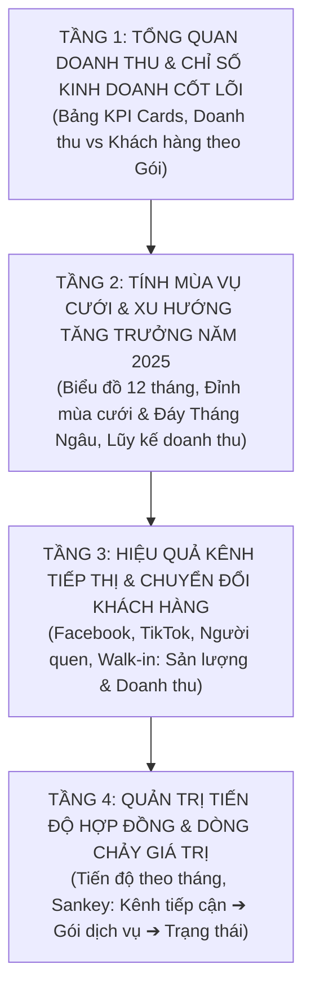

# 💍 Kế Hoạch & Đặc Tả Trực Quan Hóa Dữ Liệu Studio Wedding 2025 (Plotly)

Tài liệu này cung cấp bản thiết kế trực quan hóa chi tiết cho bài toán **Phân tích Hiệu Quả Kinh Doanh & Tăng Trưởng Dịch Vụ Cưới** của Studio Ảnh Cưới năm 2025 (`studio_wedding_2025.csv`). Toàn bộ kế hoạch được thiết kế chuyên biệt cho thư viện **Plotly**, tuân thủ nguyên tắc: **Đơn giản – Thanh lịch – Trực quan – Dễ hiểu – Dẫn dắt từ Tổng quan đến Chi tiết**.

---

## 📌 1. Tổng Quan Về Tập Dữ Liệu `studio_wedding_2025.csv`

### 1.1. Thông tin kỹ thuật
- **Quy mô dữ liệu:** 4.748 dòng dữ liệu (hợp đồng cưới), 6 cột thuộc tính.
- **Dữ liệu khuyết thiếu (Missing values):** `0` (Bộ dữ liệu sạch 100%, không khuyết thiếu).
- **Phạm vi thời gian:** Từ `01/01/2025` đến `31/12/2025` (Trọn vẹn 365 ngày của năm 2025).

### 1.2. Từ điển dữ liệu (Data Dictionary)
| Tên Cột | Kiểu Dữ Liệu | Miền Giá Trị / Thống Kê | Ý Nghĩa Kinh Doanh |
| :--- | :--- | :--- | :--- |
| `ID_KhachHang` | Chuỗi (`str`) | `KH1000` đến `KH5747` (4.748 khách) | Mã định danh từng hợp đồng/cặp đôi |
| `Ngay_Ky_Hop_Dong` | Ngày tháng (`date`) | `01/01/2025` – `31/12/2025` | Ngày ký kết hợp đồng dịch vụ cưới |
| `Goi_Dich_Vu` | Phân loại (`category`) | 3 gói: `Studio`, `Phim trường`, `Ngoại cảnh` | Phân khúc gói chụp ảnh & quay phóng sự cưới |
| `Doanh_Thu` | Số nguyên (`int64`) | 5 triệu, 10 triệu, 20 triệu (TB: 9.46 triệu) | Giá trị gói hợp đồng (VNĐ) |
| `Nguon_Khach` | Phân loại (`category`) | 4 kênh: `Facebook`, `Tiktok`, `Người quen`, `Walk-in` | Kênh tiếp cận & chuyển đổi khách hàng |
| `Trang_Thai` | Phân loại (`category`) | `Đã hoàn thành` (89.3%), `Đang thực hiện` (10.7%) | Tiến độ cung cấp dịch vụ cho khách |

### 1.3. Các chỉ số kinh doanh then chốt (Business Key Metrics)
1. **Tổng doanh thu cả năm 2025:** **44.905.000.000 VNĐ** (~44.91 tỷ đồng).
2. **Tổng số lượng hợp đồng ký kết:** **4.748 hợp đồng**.
3. **Giá trị hợp đồng trung bình (AOV - Average Order Value):** **9.457.666 VNĐ / hợp đồng**.
4. **Tỷ trọng doanh thu theo gói dịch vụ (Quy luật giá trị):**
   - **Gói Ngoại cảnh:** 938 khách (**19.8%** lượng khách) ➔ Đóng góp **18.760 tỷ VNĐ** (**41.8%** tổng doanh thu).
   - **Gói Phim trường:** 1.419 khách (**29.9%** lượng khách) ➔ Đóng góp **14.190 tỷ VNĐ** (**31.6%** tổng doanh thu).
   - **Gói Studio:** 2.391 khách (**50.4%** lượng khách) ➔ Đóng góp **11.955 tỷ VNĐ** (**26.6%** tổng doanh thu).
   - *Nhận định:* Gói Ngoại cảnh là "cỗ máy in tiền" lớn nhất dù lượng khách chỉ chiếm 1/5.
5. **Kênh Marketing chủ đạo:** Nền tảng số (Facebook + TikTok) đem lại **69.9%** lượng khách và **70.2%** doanh thu.
6. **Tỷ lệ hoàn thành hợp đồng:** **89.30%** (10.7% đang thực hiện tập trung vào các tháng cuối năm).

---

## 🎨 2. Triết Lý Thiết Kế Trực Quan Với Plotly

1. **Nguyên tắc "Đơn giản – Thẩm mỹ – Trực quan":**
   - Không lạm dụng quá nhiều màu sắc sặc sỡ; sử dụng bảng màu cao cấp, lãng mạn phù hợp ngành cưới:
     - 🌟 **Vàng kim (Warm Gold `#D4AF37`):** Đại diện cho Gói Ngoại cảnh / Hợp đồng cao cấp.
     - 🌸 **Hồng đất / Rose Gold (`#E0A96D` / `#D98880`):** Đại diện cho Gói Phim trường.
     - 💎 **Xanh ghi nhạt / Soft Teal (`#5DADE2` / `#7FB3D5`):** Đại diện cho Gói Studio tiêu chuẩn.
     - 🌿 **Xanh lục ngọc (`#27AE60`):** Đại diện cho trạng thái Đã hoàn thành.
     - ⏳ **Cam hổ phách (`#E67E22`):** Đại diện cho trạng thái Đang thực hiện.
2. **Định dạng số liệu dễ hiểu ngay lập tức:**
   - Số tiền hàng tỷ/triệu đồng được rút gọn hiển thị dạng: `18.76 Tỷ VNĐ` hoặc `9.46 Tr VNĐ` để người xem dễ nhớ, hover mới hiển thị số chi tiết.
3. **Khai thác thế mạnh tương tác của Plotly:**
   - Dropdown menu lọc xem Doanh thu hoặc Số lượng hợp đồng.
   - Range Slider thời gian để linh hoạt soi chiếu từng quý/tháng.
   - Sankey Diagram thể hiện dòng chảy khách hàng và tiền bạc cực kỳ chuyên nghiệp.

---

## 🧭 3. Bản Thiết Kế Trực Quan Hóa (Lộ Trình 4 Tầng Phân Tích)



---

### 📊 TẦNG 1: TỔNG QUAN DOANH THU & CHỈ SỐ KINH DOANH CỐT LÕI

#### Biểu đồ 1.1: Bảng Thẻ Chỉ Số Doanh Nghiệp (Executive KPI Dashboard)
- **Dạng biểu đồ:** Plotly `go.Indicator` xếp thành lưới 4 thẻ ngang.
- **Nội dung thẻ:**
  1. **Tổng Doanh Thu 2025:** `44.91 Tỷ VNĐ` (Màu Gold).
  2. **Tổng Hợp Đồng Đã Ký:** `4.748 Hợp đồng` (Màu Xanh Navy).
  3. **Giá Trị TB / Hợp Đồng (AOV):** `9.46 Triệu VNĐ` (Màu Tím Rose).
  4. **Tỷ Lệ Hoàn Thành Hợp Đồng:** `89.3%` (Màu Xanh Ngọc).
- **Mục tiêu trực quan:** Cung cấp ngay bản tóm tắt tình hình tài chính của studio chỉ trong 1 ánh nhìn.

#### Biểu đồ 1.2: So Sánh Tương Phản: Cơ Cấu Lượng Khách vs Tỷ Trọng Doanh Thu
- **Dạng biểu đồ:** Biểu đồ Tròn lồng (Donut Chart Subplots kép: `px.pie`).
  - Biểu đồ bên trái: **Cơ cấu Số lượng khách** theo Gói dịch vụ.
  - Biểu đồ bên phải: **Tỷ trọng Doanh thu** theo Gói dịch vụ.
- **Màu sắc:** Studio (`#5DADE2`), Phim trường (`#E0A96D`), Ngoại cảnh (`#D4AF37`).
- **Mục tiêu trực quan:** 
  - Làm nổi bật quy luật phân hóa giá trị:
    - Gói **Studio** chiếm một nửa số lượng hợp đồng (**50.4%**) nhưng chỉ đóng góp **26.6%** doanh thu.
    - Gói **Ngoại cảnh** chỉ chiếm chưa tới 1/5 lượng khách (**19.8%**) nhưng lại chiếm tới **41.8%** tổng nguồn thu.
  - *Ý nghĩa kinh doanh:* Chiến lược bán thêm (upsell) từ Studio lên Phim trường/Ngoại cảnh sẽ giúp bùng nổ doanh số mà không cần tăng chi phí vận hành quá nhiều.

---

### 📈 TẦNG 2: TÍNH MÙA VỤ CƯỚI & XU HƯỚNG TĂNG TRƯỞNG NĂM 2025

#### Biểu đồ 2.1: Biểu Đồ Doanh Thu & Số Hợp Đồng 12 Tháng Trong Năm
- **Dạng biểu đồ:** Kết hợp Cột & Đường trên 2 trục tung (`make_subplots`: `go.Bar` Doanh thu + `go.Scatter` Lượng hợp đồng).
- **Trục X:** 12 Tháng trong năm 2025 (Tháng 1 đến Tháng 12).
- **Trục Y1 (Trái):** Doanh thu hàng tháng (Đơn vị: Tỷ VNĐ).
- **Trục Y2 (Phải):** Số lượng hợp đồng ký mới (Đơn vị: Hợp đồng).
- **Điểm nhấn trực quan (Annotations):**
  - Đánh dấu **2 Đỉnh mùa cưới:** 
    - Đỉnh 1: **Tháng 12 & Tháng 1** (Đạt ~7.4 - 7.6 tỷ VNĐ/tháng, gần 800 hợp đồng/tháng - Mùa cưới tưng bừng dịp cuối năm và đón Tết).
    - Đỉnh 2: **Tháng 5 & Tháng 6** (Đạt 4.7 - 5.9 tỷ VNĐ/tháng - Mùa cưới đầu hè).
  - Đánh dấu **Đáy sâu văn hóa:**
    - **Tháng 8** (Chỉ đạt 1.38 tỷ VNĐ, 150 hợp đồng - Trùng với tháng 7 Âm lịch "Tháng Ngâu", người Việt kiêng kỵ cưới xin).
- **Ý nghĩa quản trị:** Giúp studio chủ động kế hoạch nhân sự (thợ chụp, trang điểm, dựng phim) và đẩy mạnh khuyến mãi vào các tháng thấp điểm để bù chi phí cố định.

#### Biểu đồ 2.2: Đường Tích Lũy Doanh Thu Lũy Kế Cả Năm (Cumulative Revenue Area)
- **Dạng biểu đồ:** Đường diện tích tích lũy (`px.area`).
- **Trục X:** 365 Ngày trong năm 2025.
- **Trục Y:** Doanh thu tích lũy (Từ 0 đến 44.91 Tỷ VNĐ).
- **Tính năng Plotly:** Thanh trượt thời gian (Date Range Slider) ở đáy biểu đồ cho phép zoom chi tiết vào từng tuần/quý.
- **Mục tiêu trực quan:** Theo dõi tiến độ chạm các mốc doanh thu: 10 tỷ (đầu tháng 3), 20 tỷ (giữa tháng 6), 30 tỷ (đầu tháng 10) và cán đích gần 45 tỷ vào cuối tháng 12.

---

### 🎯 TẦNG 3: HIỆU QUẢ KÊNH TIẾP THỊ & CHUYỂN ĐỔI KHÁCH HÀNG

#### Biểu đồ 3.1: So Sánh Doanh Thu & Quy Mô Khách Theo 4 Kênh Thu Hút
- **Dạng biểu đồ:** Cột nằm ngang xếp hạng (`px.bar` nằm ngang có nhãn giá trị trực tiếp).
- **Trục Y:** 4 Kênh tiếp cận (Sắp xếp theo doanh thu giảm dần):
  1. **Facebook:** 17.35 Tỷ VNĐ (1.864 khách - 39.3%)
  2. **Tiktok:** 14.20 Tỷ VNĐ (1.456 khách - 30.7%)
  3. **Người quen:** 9.19 Tỷ VNĐ (982 khách - 20.7%)
  4. **Walk-in:** 4.18 Tỷ VNĐ (446 khách - 9.4%)
- **Trục X:** Doanh thu (Tỷ VNĐ).
- **Nhãn hiển thị:** Hiển thị rõ cả Doanh thu (Tỷ) và Số lượng khách hàng ngay đầu thanh bar.
- **Insight kinh doanh:** Kênh Digital Marketing (Facebook + TikTok) áp đảo hoàn toàn, mang lại hơn 31.5 tỷ VNĐ. Kênh giới thiệu "Người quen" tuy không tốn chi phí quảng cáo nhưng đem lại hiệu quả rất vững chắc (>9 tỷ VNĐ).

#### Biểu đồ 3.2: Cơ Cấu Phân Khúc Gói Dịch Vụ Theo Từng Kênh Tiếp Cận
- **Dạng biểu đồ:** Cột chuẩn hóa 100% (`px.bar` dạng `barmode='fill'`).
- **Trục X:** 4 Nguồn khách (Facebook, TikTok, Người quen, Walk-in).
- **Trục Y:** Tỷ lệ % cơ cấu các gói dịch vụ (0% đến 100%).
- **Phân màu:** 3 Gói (Studio, Phim trường, Ngoại cảnh).
- **Mục tiêu trực quan:** 
  - Khám phá xem khách từ TikTok có xu hướng chọn gói rẻ hay gói đắt?
  - Dữ liệu cho thấy: Khách từ **TikTok** có tỷ lệ đặt gói **Ngoại cảnh** cao nhất (21.8%), trong khi Facebook là 18.9%. Điều này phản ánh người dùng TikTok trẻ trung, thích những bộ ảnh cưới năng động, phong cảnh độc lạ ngoài trời.

---

### 🔄 TẦNG 4: QUẢN TRỊ TIẾN ĐỘ HỢP ĐỒNG & DÒNG CHẢY GIÁ TRỊ

#### Biểu đồ 4.1: Tiến Độ Hợp Đồng Cưới Theo Tháng Ký Kết
- **Dạng biểu đồ:** Cột chồng (`px.bar` dạng `barmode='stack'`).
- **Trục X:** 12 Tháng.
- **Trục Y:** Số lượng hợp đồng.
- **Phân màu (`color`):** Trạng thái (`Đã hoàn thành`: Xanh lá, `Đang thực hiện`: Cam vàng).
- **Mục tiêu trực quan:** 
  - Các tháng từ Tháng 1 đến Tháng 10 tỷ lệ hoàn thành đạt trên 90%.
  - Tháng 11 và đặc biệt Tháng 12 có lượng đơn `Đang thực hiện` tăng vọt (Tháng 12 có 88 đơn đang thực hiện) do đặc thù chụp cưới trước ngày tổ chức tiệc từ 1 - 3 tháng. Đây là cơ sở để bộ phận hậu kỳ lên kế hoạch trả ảnh trước Tết Nguyên Đán.

#### Biểu đồ 4.2: Biểu Đồ Dòng Chảy Giá Trị Toàn Diện (Sankey Flow Diagram)
- **Dạng biểu đồ:** Plotly `go.Sankey`.
- **Luồng dịch chuyển:**
  - Cột 1 (Nguồn gốc): **4 Nguồn Khách** (Facebook, TikTok, Người quen, Walk-in).
  - Cột 2 (Phân phối): **3 Gói Dịch Vụ** (Studio, Phim trường, Ngoại cảnh).
  - Cột 3 (Kết quả): **2 Trạng Thái** (Đã hoàn thành, Đang thực hiện).
- **Giá trị luồng (Flow Value):** Doanh thu tiền mặt (VNĐ) hoặc Số lượng hợp đồng.
- **Mục tiêu trực quan:** Một biểu đồ tương tác đỉnh cao của Plotly, cho phép người dùng click và hover vào từng dải luồng để thấy toàn bộ hành trình chuyển hóa từ tiền quảng cáo tiếp thị thành doanh thu thực tế.

---

## 📋 4. Bảng Đặc Tả Kỹ Thuật Biểu Đồ Plotly

| STT | Tên Biểu Đồ | Module / Hàm Plotly | Trục X / Danh Mục | Trục Y / Đo Lường | Chiều Màu / Kích Thước | Hover Data & Tooltip |
| :---: | :--- | :--- | :--- | :--- | :--- | :--- |
| **1** | Bảng Thẻ KPI Doanh Nghiệp | `go.Indicator` | 4 Cards | Doanh thu, Hợp đồng, AOV, % Hoàn thành | Màu thương hiệu | Giá trị thực, % tỷ trọng |
| **2** | Tương Phản Khách vs Doanh Thu | `px.pie` (Donut kép Subplots) | 3 Gói Dịch Vụ | Trái: Số khách; Phải: Doanh thu | 3 Gói Dịch Vụ | Tên gói, Số lượng, Doanh thu, % |
| **3** | Mùa Vụ & Xu Hướng 12 Tháng | `make_subplots` (Bar + Line) | Tháng (1-12) | Trái: Doanh thu (Tỷ); Phải: Số HĐ | Loại số liệu | Tháng, Doanh thu, Số hợp đồng |
| **4** | Doanh Thu Tích Lũy 365 Ngày | `px.area` + RangeSlider | Ngày ký trong năm | Doanh thu lũy kế (Tỷ VNĐ) | Màu gradient | Ngày cụ thể, Tổng lũy kế |
| **5** | Xếp Hạng Kênh Thu Hút | `px.bar` (Nằm ngang) | Doanh thu (Tỷ VNĐ) | 4 Kênh tiếp cận | 4 Kênh tiếp cận | Kênh, Doanh thu, Số khách, % |
| **6** | Cơ Cấu Gói Theo Kênh Tiếp Thị | `px.bar` (barmode='fill') | 4 Kênh tiếp cận | Tỷ lệ % (100%) | 3 Gói dịch vụ | Kênh, Gói dịch vụ, Tỷ lệ % |
| **7** | Tiến Độ Thực Hiện Theo Tháng | `px.bar` (barmode='stack') | Tháng (1-12) | Số hợp đồng | Trạng thái (Xong vs Đang làm) | Tháng, Trạng thái, Số lượng |
| **8** | Dòng Chảy Giá Trị Khách Hàng | `go.Sankey` | Kênh ➔ Gói ➔ Trạng thái | Độ dày luồng: Doanh thu / Khách | Nút chuyển đổi | Tên nút nguồn, Nút đích, Giá trị luồng |

---

## 💻 5. Đoạn Code Khởi Tạo Mẫu Chuẩn (Plotly Boilerplate)

```python
import pandas as pd
import plotly.express as px
import plotly.graph_objects as go
from plotly.subplots import make_subplots

# 1. Đọc dữ liệu và xử lý thời gian
df = pd.read_csv("data/studio_wedding_2025.csv")
df["Ngay_Ky_Hop_Dong"] = pd.to_datetime(df["Ngay_Ky_Hop_Dong"])
df["Tháng"] = df["Ngay_Ky_Hop_Dong"].dt.month
df["Doanh_Thu_Ty"] = df["Doanh_Thu"] / 1e9  # Quy đổi sang đơn vị Tỷ VNĐ

# 2. Bảng màu thương hiệu cưới sang trọng
WEDDING_COLORS = {
    "Ngoại cảnh": "#D4AF37",    # Warm Gold
    "Phim trường": "#E0A96D",   # Rose Gold
    "Studio": "#5DADE2"         # Soft Teal
}

# 3. Code mẫu Biểu đồ Doanh thu 12 tháng kết hợp đường & cột
monthly_stat = df.groupby("Tháng").agg(
    Doanh_Thu=("Doanh_Thu_Ty", "sum"),
    So_Hop_Dong=("ID_KhachHang", "count")
).reset_index()

fig = make_subplots(specs=[[{"secondary_y": True}]])

# Cột Doanh thu
fig.add_trace(
    go.Bar(
        x=monthly_stat["Tháng"],
        y=monthly_stat["Doanh_Thu"],
        name="Doanh thu (Tỷ VNĐ)",
        marker_color="#D4AF37",
        hovertemplate="Tháng %{x}: <b>%{y:.2f} Tỷ VNĐ</b><extra></extra>"
    ),
    secondary_y=False
)

# Đường Số hợp đồng
fig.add_trace(
    go.Scatter(
        x=monthly_stat["Tháng"],
        y=monthly_stat["So_Hop_Dong"],
        name="Số hợp đồng",
        mode="lines+markers",
        line=dict(color="#2C3E50", width=3),
        marker=dict(size=8),
        hovertemplate="Số HĐ: <b>%{y:,} hợp đồng</b><extra></extra>"
    ),
    secondary_y=True
)

fig.update_layout(
    title="<b>Diễn Biến Doanh Thu & Lượng Hợp Đồng Cưới 12 Tháng Năm 2025</b>",
    title_x=0.5,
    xaxis=dict(title="Tháng ký hợp đồng", tickmode="linear", tick0=1, dtick=1),
    yaxis=dict(title="Doanh thu (Tỷ VNĐ)", showgrid=True),
    yaxis2=dict(title="Số lượng hợp đồng", showgrid=False),
    template="plotly_white",
    hovermode="x unified"
)
# fig.show()
```

---
*Tài liệu được soạn thảo làm kim chỉ nam trực quan hóa tương tác cho bộ dữ liệu Studio Cưới 2025.*
